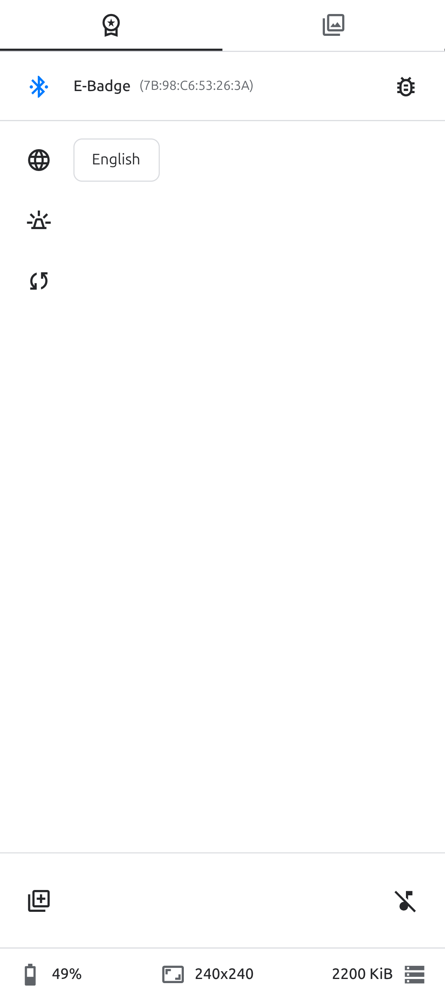
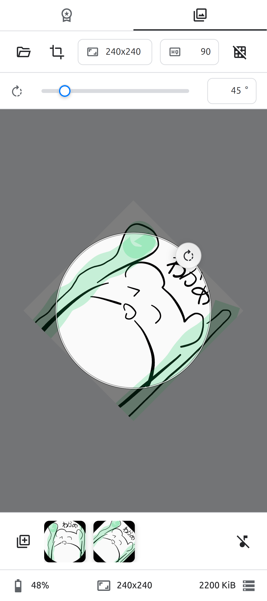
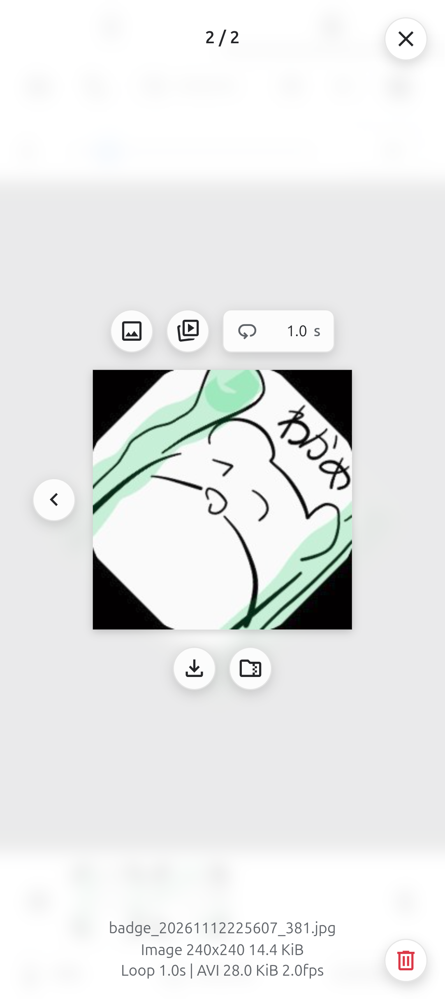
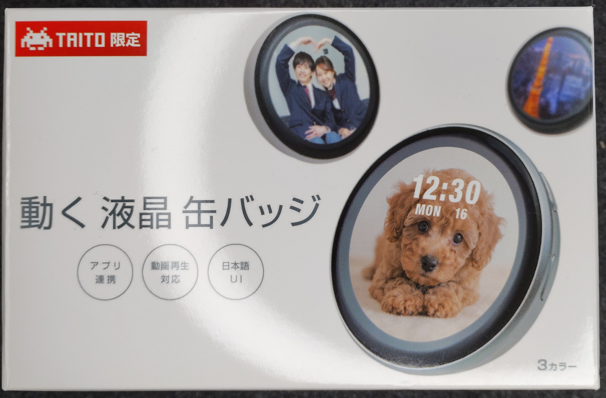
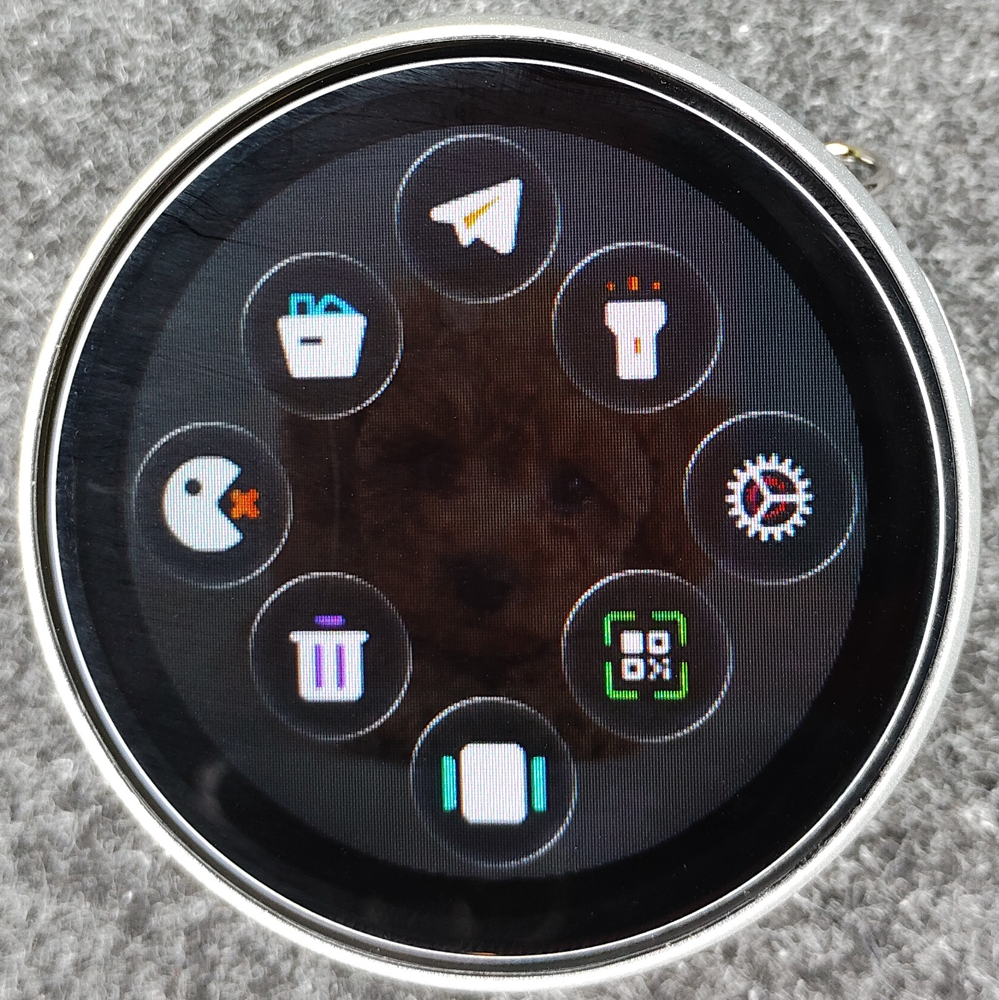
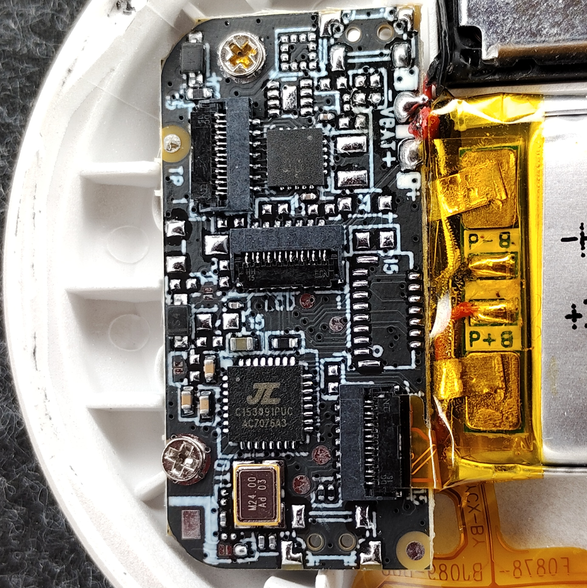
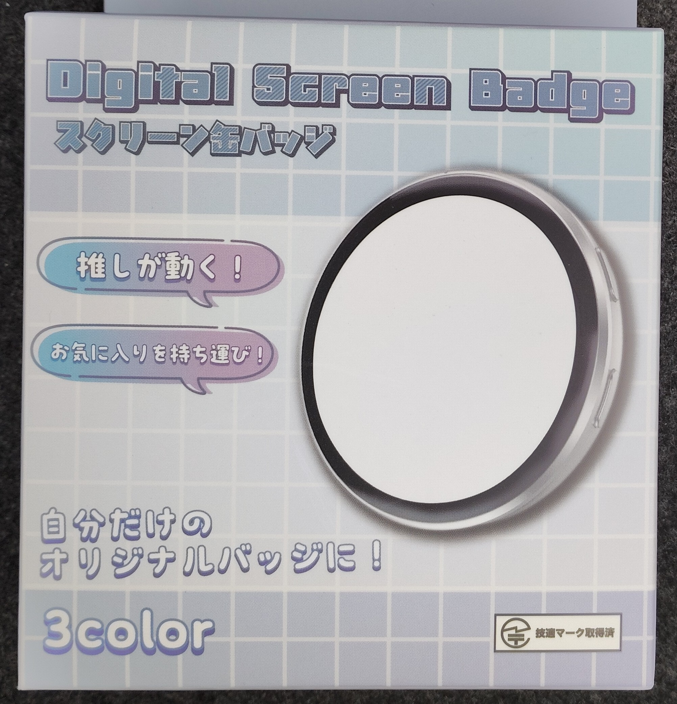
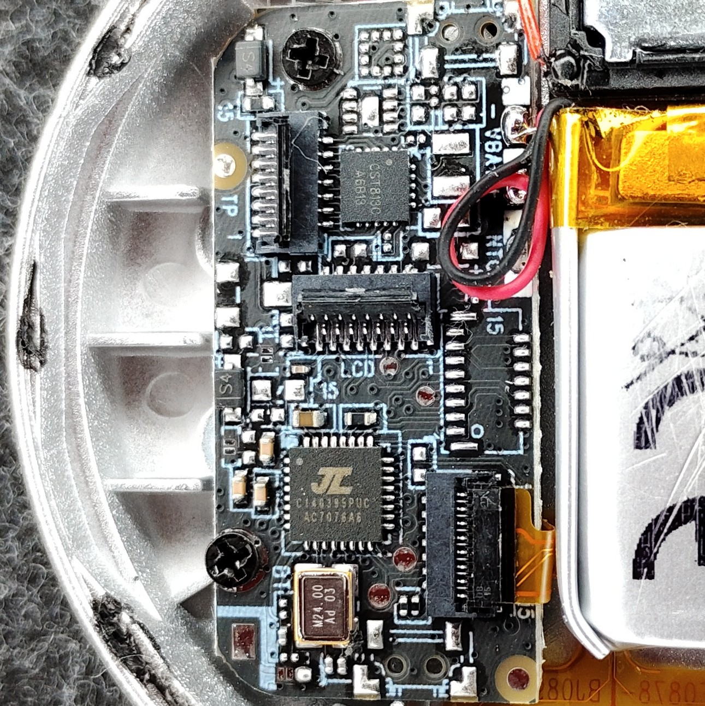

# Web Badge Studio

Try it from [here](https://usokawa.github.io/web-badge-studio/web-badge-studio.html)!

_(Note: iOS / Safari / Firefox are not supported due to lack of Web Bluetooth support.)_

[User Manual](help.en.html) / [取扱説明書](help.ja.html)

## Supported badges

* タイトー 動く液晶缶バッジ (BW03 240x240 AC7076A3 4MiB)

* ビーサイレンス スクリーン缶バッジ (E-Badge 240x240 4MiB)

* BG02 240x240 AC7076A6 2MiB

* BJ-1 360x360 4MiB

This may be compatible with badges that use the SuperBand app ([Google](https://play.google.com/store/apps/details?id=com.legend.smartwatch.electronicbadge.android) / [Apple](https://apps.apple.com/app/superband/id1514892138)).
